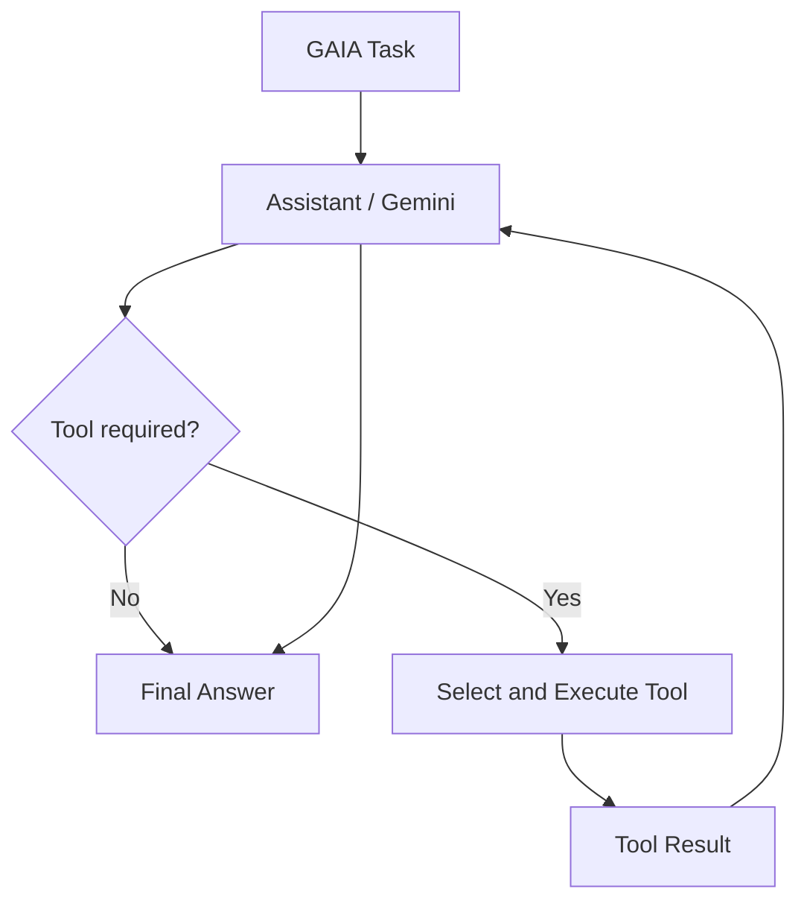

# GAIA Benchmark Agent

An AI agent built with **LangChain, LangGraph, and Google's Gemini models** to solve tasks from the [GAIA benchmark](https://huggingface.co/datasets/gaia-benchmark/GAIA).

The agent combines reasoning, tool use, web research, document processing, and multimodal analysis to answer questions involving different types of information and file attachments.

**Test score: 90/100**

This project was developed as the final assignment for the Hugging Face Agents Course and is based on the [Final Assignment Template](https://huggingface.co/spaces/agents-course/Final_Assignment_Template).

---

## Overview

GAIA (General AI Assistants) is a benchmark designed to evaluate the capabilities of general-purpose AI assistants, using questions of difficulties from level 1-3. 

This project implements an agent that can interpret a task, determine which tools are needed, execute them, and use the resulting information to produce an answer to 20 level 1 questions.

Rather than relying exclusively on the language model's internal knowledge, the agent can interact with external sources and inspect provided files.

### Key features

- **Tool-using agent:** Dynamically selects and executes tools based on the task.
- **Web research:** Searches the web and retrieves information from relevant websites.
- **File processing:** Reads and analyses text files, CSV files, and Excel spreadsheets.
- **Attachment handling:** Downloads and processes files associated with GAIA benchmark tasks.
- **Image analysis:** Uses a vision-capable language model to describe and extract information from images.
- **Audio analysis:** Supports analysis of MP3 audio files using a multimodal language model.
- **Structured workflows:** Uses LangGraph to manage the agent's reasoning and tool-execution cycle.
- **Error handling:** Includes retry handling and a fallback mechanism for situations where the agent reaches its tool-use limit.

---

## Architecture

The agent is implemented using LangChain and LangGraph.

LangChain provides the language model interface and tool integration, while LangGraph manages the execution flow and the interaction between the assistant and its tools.

The main workflow consists of three components:

1. **Assistant:** Receives the task and decides whether to answer directly or invoke a tool.
2. **Tools:** Execute the selected operation and return the result.
3. **Assistant:** Receives the tool output, evaluates the information, and either calls another tool or produces the final answer.

### Workflow

A recursion limit prevents the graph from running indefinitely. If this limit is reached, the agent attempts to generate a final answer using the information already gathered, rather than starting the task again.

### Language model

The agent uses Google's Gemini 3.5 Flash Lite model through the Gemini API.

The model is responsible for:

- Understanding the task and identifying the information needed.
- Selecting appropriate tools.
- Interpreting tool outputs.
- Combining information from multiple sources.
- Producing the final answer.

The same underlying model is also used for multimodal tasks such as image and audio analysis.

---

## Available tools

The agent has access to several tools designed to cover different types of GAIA tasks.

| Tool | Purpose |
|---|---|
| `search_and_read_web_tool` | Searches the web and retrieves information from relevant results. |
| `visit_website_tool` | Visits a specific website to retrieve its content. |
| `download_gaia_attachment` | Downloads files associated with a GAIA benchmark task from the Hugging Face dataset. |
| `read_text_tool` | Reads and extracts content from text files. |
| `read_csv_tool` | Reads CSV files using Pandas, including handling files containing metadata before the actual tabular data. |
| `read_excel_tool` | Reads and analyses Excel spreadsheets using Pandas. |
| `describe_image_assistant` | Uses a multimodal language model to describe images and interpret their contents. |
| `extract_text_from_image_assistant` | Extracts textual information from images. |
| `analyze_mp3_tool` | Analyses MP3 audio files using a multimodal language model. |

### Web research

The web research tools allow the agent to retrieve information that is not available in its initial context.

The agent can search for relevant sources and inspect website content to answer questions requiring external information.

The system prompt encourages the agent to avoid unnecessary searches, reuse relevant results, and stop browsing once sufficient information has been obtained.

### File and attachment processing

Some GAIA tasks include attachments that contain essential information.

The agent can download these attachments and select an appropriate tool based on the file type.

Supported processing includes:

- Text extraction from text files.
- Tabular data analysis using Pandas.
- Excel spreadsheet analysis.
- Image description and text extraction.
- Audio analysis.

For tasks involving attachments, the agent is instructed to inspect the provided files before attempting to find the answer through external web searches.

## Evaluation

<badge color="success" size="lg">90/100</badge>

The agent achieved a **test score of 90/100** during evaluation.

The project was tested against 20 level 1 GAIA benchmark tasks involving different types of reasoning and information retrieval.

The evaluation covers tasks requiring capabilities such as:

- Retrieving and combining information from web sources.
- Identifying relevant information in attached files.
- Analysing structured tabular data.
- Extracting information from images.
- Handling tasks requiring multiple tool calls.

The score reflects the agent's performance in the project's test run. It should not be interpreted as an official GAIA leaderboard ranking.

---

## Running the project

### Requirements

- Python 3.10
- A Google Gemini API key
- A Hugging Face access token for accessing GAIA dataset attachments, where required

### Environment variables

The application uses the following environment variables:

| Variable | Description |
|---|---|
| `GEMINI_API_KEY` | API key used to access Google's Gemini models. |
| `HF_TOKEN` | Hugging Face access token used when downloading benchmark attachments. |

When running locally, these can be configured as environment variables.

For a Hugging Face Space, add them under **Settings → Variables and secrets**. Store API keys and access tokens as secrets rather than hardcoding them in the source code.

## Error handling and limitations

The project includes several mechanisms to make agent execution more robust.

### Tool-use limits

The LangGraph workflow has a recursion limit to prevent excessive tool calls and repeated execution cycles.

If the agent reaches this limit, it attempts to produce a final answer based on the messages and tool results already collected.

### API errors and rate limits

Gemini API requests can occasionally fail because of temporary service unavailability (`503`) or rate limits (`429`).

The fallback mechanism includes a retry after a waiting period for these errors.

However, retries cannot resolve persistent quota restrictions or exhausted API allowances.

### General limitations

- Language model outputs are not deterministic and may vary between runs.
- API rate limits and model availability can affect execution time and successful task completion.
- Lack of video analysis capabilities.
- Lack of advanced chess understanding.

---

## Project background

This project was developed as the final assignment of the **Hugging Face Agents Course**.

It is based on the official [Final Assignment Template](https://huggingface.co/spaces/agents-course/Final_Assignment_Template), which provides the starting point for implementing and evaluating an agent against the GAIA benchmark.

The project extends that foundation with tools for web research, file handling, spreadsheet analysis, image processing, and audio analysis.

The main objective was to build a general-purpose agent capable of selecting and using appropriate tools to solve a diverse range of tasks.

---

## Acknowledgements

- [Hugging Face Agents Course](https://huggingface.co/learn/agents-course/)
- [Final Assignment Template](https://huggingface.co/spaces/agents-course/Final_Assignment_Template)
- [GAIA Benchmark](https://huggingface.co/datasets/gaia-benchmark/GAIA)
- [LangChain](https://www.langchain.com/)
- [LangGraph](https://www.langchain.com/langgraph)
- [Google Gemini](https://ai.google.dev/)

